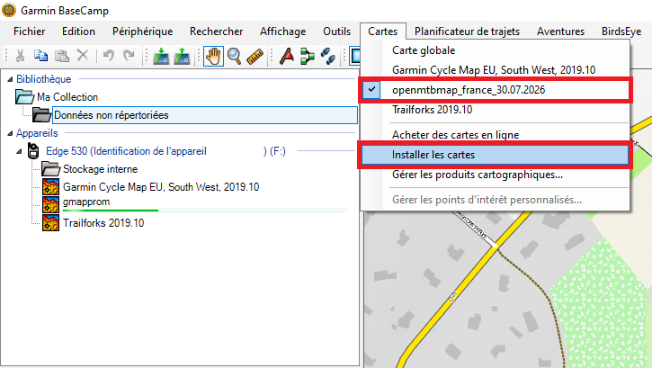
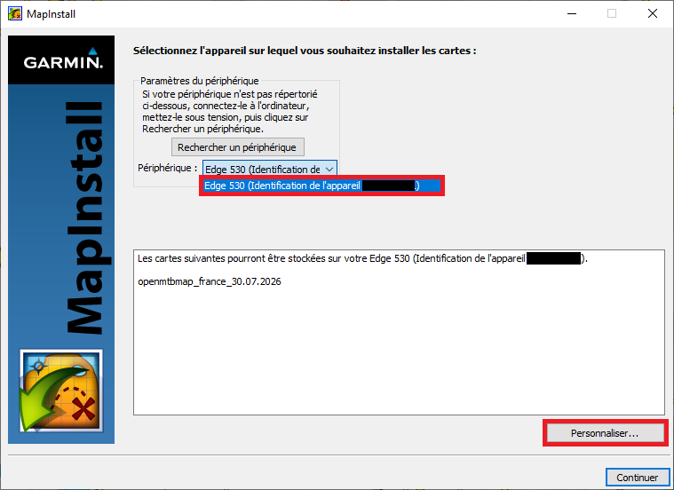
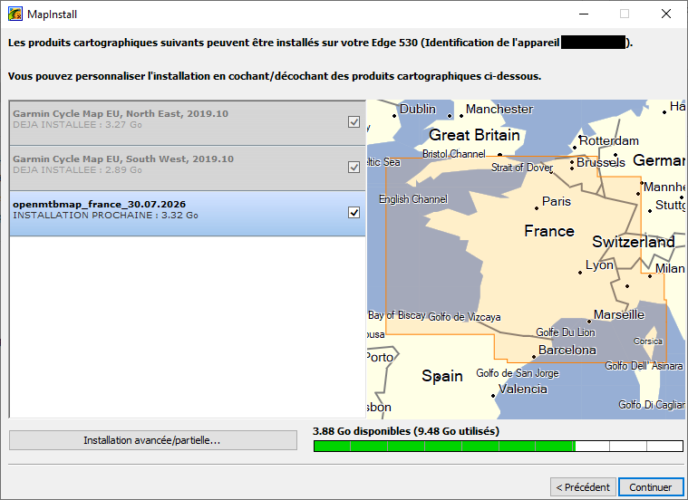

# Carte Garmin Edge
## 1 - Les cartes

Il existe 2 versions pour les cartes <a href="https://openmtbmap.org/" target="_blank" rel="noopener noreferrer">openmtbmap :fontawesome-solid-arrow-up-right-from-square:</a> (Carte VTT) et <a href="https://www.velomap.org/" target="_blank" rel="noopener noreferrer">velomap :fontawesome-solid-arrow-up-right-from-square:</a> (Carte Route). Choisissez celle qui convient à votre pratique.

!!! note "Information importante"
    Toutes les manipulations sont identiques pour les __2 cartes__.

Compatibilité des appareils :

- Tous les appareils Garmin commercialisés en 2016 et les années suivantes
- Edge 1000

Assurez-vous également d'avoir une carte SD d'au moins 16gb sur votre appareil, car par exemple la carte de la France fait environ 4gb. 

---

## 2 - Préparation

### Installation de BaseCamp

Pour Installer une carte il vous faut obligatoirement télécharger la dernière version du logiciel <a href="https://www.garmin.com/fr-FR/software/basecamp/" target="_blank" rel="noopener noreferrer">Garmin BaseCamp :fontawesome-solid-arrow-up-right-from-square:</a>.  

Pour l'installation rien de particulier à effectuer juste choisir l'emplacement ou vous souhaiter installer le logiciel.  

### Installation de la carte

Pour installer la carte Française de VTT, vous pouvez y accéder par le lien suivant :

- <a href="https://openmtbmap.org/donate/odbl/download_france_en.html" target="_blank" rel="noopener noreferrer">openmtbmap.org/donate/odbl/download :fontawesome-solid-arrow-up-right-from-square:</a>

Ou la carte Française Route :

- <a href="https://www.velomap.org/donate/odbl/download_france_en.html" target="_blank" rel="noopener noreferrer">velomap.org/donate/odbl/download :fontawesome-solid-arrow-up-right-from-square:</a>

!!! info "Information"

    Si besoin, vous pouvez consulter le Tuto suivant pour l'installer :
    <a href="https://openmtbmap.org/tutorials/install/" target="_blank" rel="noopener noreferrer">openmtbmap.org/tutorials/install/ :fontawesome-solid-arrow-up-right-from-square:</a>

---

## 3 - Installation

Après avoir téléchargé le logiciel et la carte, vous pouvez maintenant connecter votre appareil à votre ordinateur si ce n'est pas déjà fait.

??? note

    Des bruits de connexions/déconnexions peuvent survenir si c'est la première fois que vous branchez l'appareil sur votre ordinateur, je vous conseille de patienter au moins 5 minutes que les cartes par défaut se           chargent, avant d'installer la carte sur votre appareil afin d'éviter tout problèmes.

Une fois dans le logiciel, naviguez dans la section __Carte__ puis sélectionner la carte précédemment installé (__openmtbmap_france_xxxxx__) et enfin __Installer les cartes__.

<figure markdown="span">
  { width="700" }
</figure>

Ensuite, __sélectionner votre appareil__ (dans mon cas le Edge 530) puis __Personnaliser__.

<figure markdown="span">
  { width="700" }
</figure>

Pour finir, il faut __cochez la carte à installer__ et vérifier qu'il vous reste un peu de place.

<figure markdown="span">
  { width="700" }
</figure>

---

## 4 - Configuration sur l'apparreil

Vous pouvez maintenant déconnecter votre appareil et l'allumer.

Maintenant il faut changer la carte par défaut par celle que nous venons d'installer, pour ce faire sélectionnez __Menu__ -> __Paramètres__ -> __Profils d'activité__ -> __Sélectionner un profil (VTT, Route etc...)__ -> __Navigation__ -> __Information carte__ puis __openmtbmap_france_xxxxx__.

!!! note "Information importante"

    Garmin a introduit un mode contraste élevé complètement défectueux, qui décolore les couleurs des cartes. Vous pouvez désactiver ce mode en effectuant la modification suivante sous
    __Menu__ -> __Paramètres__ -> __Profils d'activité__ -> __Sélectionnez un profil__ -> __Navigation__ -> __Carte__ -> __Thème de la carte__ -> __CLASSIQUE__

