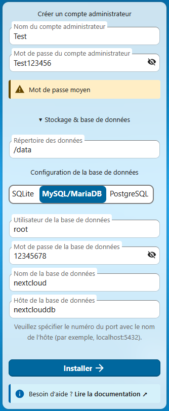

# Installation

## 1 - Fichier docker compose

``` yaml
services:
  nextcloud:
    image: lscr.io/linuxserver/nextcloud:latest
    container_name: nextcloud 
    environment:
      - PUID=996  # (1)!
      - PGID=100  
      - TZ=Europe/Paris
    volumes:
      - /home/docker/appdata/nextcloud/config:/config
      - /srv/dev-disk-by-uuid-d227d194-33c9-41e2-acba-298e66d25778/docker/appdata/nextcloud/data:/data
    depends_on:
      - mariadb      
    ports:
      - 450:443
    restart: unless-stopped

  mariadb:
    image: lscr.io/linuxserver/mariadb:latest
    container_name: nextclouddb
    environment:
      - PUID=996	
      - PGID=100
      - TZ=Europe/Paris
      - MYSQL_ROOT_PASSWORD=12345678 # (2)!
    volumes:
      - /home/docker/appdata/nextclouddb/config:/config  
    restart: unless-stopped

networks:
  default:
    name: nextcloud
```

1.  Pour trouver l'id de l'utilisateur et du groupe faite la commande "id" suivie du nom de votre utilisateur.
    <div style="page-break-after: always;"></div>
    (l'utilisateur root est toujours O)

2.  Génerer un mot de passe fort pour la base de données (évitez les caractères spéciaux/mot de passe trop long)

## 2 - Installation
Après avoir démarré votre stack, connecter vous a l'interface web de nextcloud. Puis, entrez les informations suivantes :

- Nom du compte de l'administrateur `Test`
- Mot de passe `Test123456`
- Répertoire de la base de données `/data`, cela corespond à notre point de montage définit dans le fichier compose :
``` yaml
volumes:
  - .../appdata/nextcloud/data:/data
```
- Configuration de la base de données `MySQL/MariaDB`
- Utilisateur de la base de données `root`
- Mot de passe de la base de données `12345678`, cela corsepond à la valeur défini dans la variable d'environnement suivante :
``` yaml
environment:
  - MYSQL_ROOT_PASSWORD=12345678
```
- Nom de la base de données `nextcloud`
- Hôte de la base de données `nextclouddb`, cela corsepond au nom du conteneur : 
``` yaml
container_name: nextclouddb
```

<figure markdown="span">
  { width="350" }
</figure>

---

## Sources

- <a href="https://docs.linuxserver.io/images/docker-nextcloud/" target="_blank" rel="noopener noreferrer">linuxserver (docker nextcloud)</a>
- <a href="https://docs.linuxserver.io/images/docker-mariadb/" target="_blank" rel="noopener noreferrer">linuxserver (docker mariadb)</a>

---
