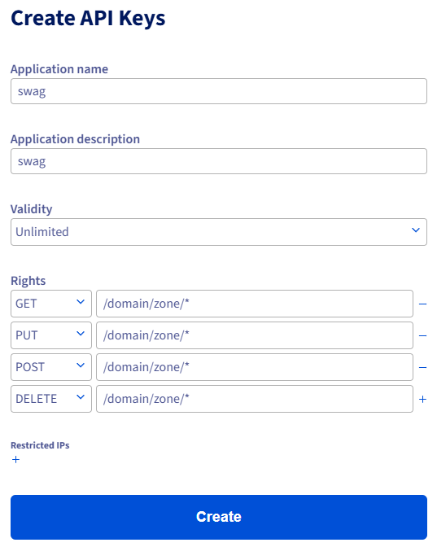

# Installation

## 1 - Préparation du nom de domaine

Chez notre fournisseur DNS, il vous faut créer un enregistrement `A` pour le domaine principal et le faire pointer vers __l'adresse IP__ de votre box/routeur (WAN). Il faut également créer un enregistrement `CNAME` wildcard `*` et le faire pointer vers l'enregistrement `A` du domaine. 

!!! note "Information importante"
    Sur Cloudflare, Il faut décocher __le nuage orange__ pour le rendre gris afin qu'il ne s'agisse que d'une requête DNS et non d'une requête mise en cache ou relayée par Cloudflare, ce qui complexifierait inutilement la configuration.


## 2 - Fichier docker compose

### Méthode Cloudflare
Exemple de configuration avec un nom de domaine enregistré chez __Cloudflare__

``` yaml
services:
  swag:
    image: lscr.io/linuxserver/swag:latest
    container_name: swag
    cap_add:
      - NET_ADMIN
    environment:
      - PUID=1000
      - PGID=1000
      - TZ=Europe/Paris
      - URL=exemple.fr
      - SUBDOMAINS=wildcard
      - VALIDATION=dns
      - DNSPLUGIN=cloudflare
    volumes:
      - /home/docker/appdata/swag/config:/config
    ports:
      - 443:443
    networks:
      swag_net:
        ipv4_address: 172.25.0.5
    restart: unless-stopped

networks:
  swag_net:
    driver: bridge
    ipam:
      driver: default
      config:
        - subnet: 172.25.0.0/16
          gateway: 172.25.0.1
```

Une fois le conteneur démarré, il faut consulter les logs :
```
docker logs swag -f
```
Après quelques étapes d'initialisation, nous constaterons qu'une erreur de validation se produit en raison d'identifiants incorrects. En effet, nous n'avons pas encore saisi les identifiants corrects pour l'API Cloudflare. Nous pouvons accéder à l'emplacement /config/dns-conf mappé depuis l'hôte (conformément aux paramètres ci-dessus) /home/docker/appdata/swag/config/dns-conf/ et modifier le fichier __.ini__ correspondant à notre fournisseur DNS. Pour Cloudflare, nous saisirons notre jeton d'API. 

!!! note "Information importante"
    Ce jeton peut être créé en accédant à Mon profil > Jetons d'API et en créant un jeton disposant de l'autorisation « Modifier le DNS » sur les zones DNS pour lesquelles vous souhaitez demander des certificats.

Dans le fichier __cloudflare.ini__, commentez les valeurs : 

- __dns_cloudflare_email__ 
- __dns_cloudflare_api_key__ 

puis décommentez __dns_cloudflare_api_token__ et ajoutez votre jeton d'API.

Contenu du fichier __cloudflare.ini__ :
``` ini
# Instructions: https://github.com/certbot/certbot/blob/master/certbot-dns-cloudflare/certbot_dns_cloudflare/__init__.py#L20
# Replace with your values

# With global api key:
# dns_cloudflare_email = cloudflare@example.com
# dns_cloudflare_api_key = 0123456789abcdef0123456789abcdef01234567

# With token (comment out both lines above and uncomment below):
dns_cloudflare_api_token = 0123456789abcdef0123456789abcdef01234567
```
Une fois les identifiants saisis dans le fichier __.ini__, il faut redémarer le conteneur Docker :
```
docker restart swag 
```
Après validation, une notification devrait s'afficher `Server read yet` notre serveur web devrait être opérationnel et accessible à l'adresse `https://www.exemple.fr`.

### Méthode OVH

Exemple de configuration avec un nom de domaine enregistré chez __OVH__

``` yaml
services:
  swag:
    image: lscr.io/linuxserver/swag:latest
    container_name: swag
    cap_add:
      - NET_ADMIN
    environment:
      - PUID=1000
      - PGID=1000
      - TZ=Europe/Paris
      - URL=exemple.fr
      - SUBDOMAINS=wildcard
      - VALIDATION=dns
      - DNSPLUGIN=ovh
    volumes:
      - /home/docker/appdata/swag/config:/config
    ports:
      - 443:443
    networks:
      swag_net:
        ipv4_address: 172.25.0.5
    restart: unless-stopped

networks:
  swag_net:
    driver: bridge
    ipam:
      driver: default
      config:
        - subnet: 172.25.0.0/16
          gateway: 172.25.0.1
```

Une fois le conteneur démarré, il faut consulter les logs :
```
docker logs swag -f
```

Après quelques étapes d'initialisation, nous constaterons qu'une erreur de validation se produit en raison d'identifiants incorrects. En effet, nous n'avons pas encore saisi les identifiants corrects pour l'API OVH. Nous pouvons accéder à l'emplacement /config/dns-conf mappé depuis l'hôte (conformément aux paramètres ci-dessus) /home/docker/appdata/swag/config/dns-conf/ et modifier le fichier __.ini__ correspondant à notre fournisseur DNS. Pour OVH, nous saisirons nos jetons d'API. 

!!! note "Information importante"
    Ce jeton peut être créé en accédant via ce lien : <a href="https://auth.eu.ovhcloud.com/api/createToken" target="_blank" rel="noopener noreferrer">auth.eu.ovhcloud.com/api/createToken</a>
    <div style="page-break-after: always;"></div>
    il vous sufit ensuite de renseigner les informations suivantes conformément à la documentation de certbot <a href="https://github.com/certbot/certbot/blob/master/certbot-dns-ovh/certbot_dns_ovh/__init__.py" target="_blank" rel="noopener noreferrer">github.com/certbot/certbot/blob/master/certbot-dns-ovh/certbot_dns_ovh/__init__.py</a>:
    <figure markdown="span">
      { width="350" }
    </figure>

Dans le fichier __ovh.ini__, remplacez les valeurs suivantes avec vos jetons : 

- __dns_ovh_application_key__ 
- __dns_ovh_application_secret__ 
- __dns_ovh_consumer_key__

Une fois les identifiants saisis dans le fichier __.ini__, il faut redémarer le conteneur Docker :
```
docker restart swag 
```
Après validation, une notification devrait s'afficher `Server read yet` notre serveur web devrait être opérationnel et accessible à l'adresse `https://www.exemple.fr`.

---

## Sources

- <a href="https://docs.linuxserver.io/general/swag/" target="_blank" rel="noopener noreferrer">docs.linuxserver.io/general/swag/</a>
- <a href="https://www.forum-nas.fr/threads/tuto-installer-swag-en-docker-reverse-proxy.15057/" target="_blank" rel="noopener noreferrer">www.forum-nas.fr/threads/tuto-installer-swag-en-docker-reverse-proxy.15057/</a>
- <a href="https://docs.linuxserver.io/general/swag/" target="_blank" rel="noopener noreferrer">docs.linuxserver.io/general/swag/</a>
- <a href="https://docs.linuxserver.io/general/swag/" target="_blank" rel="noopener noreferrer">docs.linuxserver.io/general/swag/</a>

---
