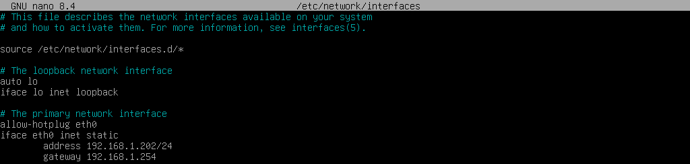
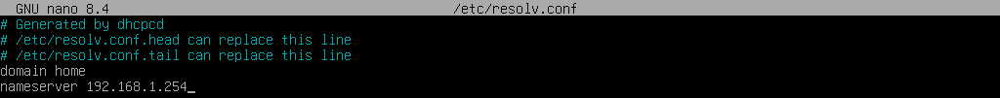
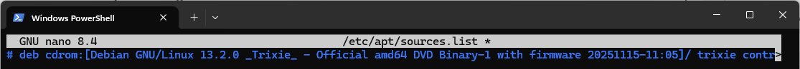
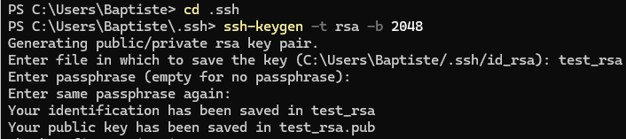
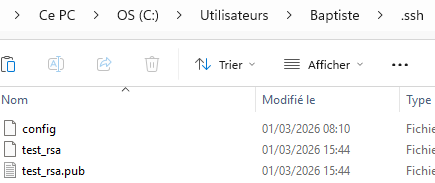
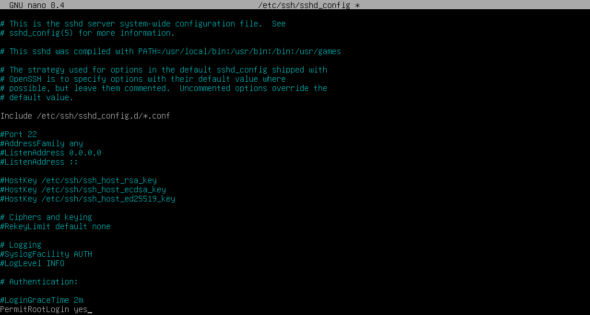

<iframe width="560" height="315" src="https://www.youtube.com/embed/_JuY79L8_qA?si=YMydbcmHpW5P0bMi" title="YouTube video player" frameborder="0" allow="accelerometer; autoplay; clipboard-write; encrypted-media; gyroscope; picture-in-picture; web-share" referrerpolicy="strict-origin-when-cross-origin" allowfullscreen></iframe>


# Configuration de base
:material-calendar-blank: __01/03/2026__ - :material-calendar-edit: __01/09/2026__
## __1 - Configuration Réseau__
### Ajout d'une IP fixe
Pour basculer la machine en adresse IP fixe, il faut modifier son interface.
<div style="page-break-after: always;"></div>
Pour modifier le fichier « interfaces », il faut effectuer la commande :
<div style="page-break-after: always;"></div>
```
nano /etc/network/interfaces 
```
Contenu du fichier interfaces :
<figure markdown="span">
  { width="800" }
</figure>
Il sufit de changer le mode "dhcp" en "static" puis d'ajouter :
```
address <adresse>/<masque>
gateway <adresse>
```

??? note "Manipulation sur debian 12"

    ```
    address <adresse>/<masque>
    gateway <adresse>
    dns-nameservers <adresse1> <adresse2>
    ```

### Configuration des serveurs DNS
!!! warning "Attention"
    Manupulation déjà effectué dans la configuration ci-dessus sur debian 12
    <div style="page-break-after: always;"></div>
    [:octicons-arrow-right-24: Lien vers la suite](#2-ajout-des-depots-de-mise-a-jour)
Ensuite, pour modifier le serveur DNS il faut aller modifier le fichier "resolv.conf"
```
nano /etc/resolv.conf 
```
il sufit d'ajouter votre domaine ainsi que l'adresse IP de votre routeur ou utiliser les serveurs DNS de Cloudflare, Google etc..
```
domain home
nameserver 192.168.1.254
```

Contenu du fichier :
<figure markdown="span">
  { width="800" }
</figure>

!!! note "Information importante"
    Il est également possible de rajouter un deuxième serveur DNS
    ```
    domain home
    nameserver 192.168.1.254
    nameserver 8.8.8.8
    ```
Afin que les modifications soit prise en compte, il faut redémarer le service réseau de la machine en effectuant :
```
systemctl restart networking.service
```
---

## __2 - Ajout des dépôts de mise à jour__ 
Tout d'abord, il faut créer un nouveau dépôt :
```
nano /etc/apt/sources.list.d/debian.sources
```
!!! note "Information importante"
    Manipulation sur debian 12
    ```
    nano /etc/apt/sources.list
    ```
Ajout des dépôts selon sa version :

=== "Debian 13 (Trixie)"

    ```
    Types: deb deb-src
    URIs: https://deb.debian.org/debian
    Suites: trixie trixie-updates
    Components: main non-free-firmware
    Enabled: yes
    Signed-By: /usr/share/keyrings/debian-archive-keyring.gpg

    Types: deb deb-src
    URIs: https://security.debian.org/debian-security
    Suites: trixie-security
    Components: main non-free-firmware
    Enabled: yes
    Signed-By: /usr/share/keyrings/debian-archive-keyring.gpg

    ```
=== "Debian 12 (Bookworm)"

    ```
    deb http://deb.debian.org/debian bookworm main contrib non-free non-free-firmware
    deb-src http://deb.debian.org/debian bookworm main contrib non-free non-free-firmware

    # bookworm-security
    deb http://deb.debian.org/debian-security/ bookworm-security main contrib non-free non-free-firmware
    deb-src http://deb.debian.org/debian-security/ bookworm-security main contrib non-free non-free-firmware

    # bookworm-updates
    deb http://deb.debian.org/debian bookworm-updates main contrib non-free non-free-firmware
    deb-src http://deb.debian.org/debian bookworm-updates main contrib non-free non-free-firmware

    # bookworm-backports
    deb http://deb.debian.org/debian bookworm-backports main contrib non-free
    deb-src http://deb.debian.org/debian bookworm-backports main contrib non-free
    ```

Puis enlever le support d'installation :

```
nano /etc/apt/sources.list
```
il faut rajouter un `#` avant le `deb cdrom:` :

<figure markdown="span">
  { width="800" }
</figure>

## __3 - Création de certificat SSH__
Pour génerer un certificat, il faut d'abord ouvrir le Terminal en Administrateur dans Windows puis se déplacer dans le répertoire suivant :
```
cd .ssh 
```
entrer la commande suivante :
```
ssh-keygen -t rsa -b 2048 
```
<figure markdown="span">
  { width="800" }
</figure>

Il faut ensuite spécifier :

- le nom (test_rsa)
- la passphrase (optionel)

Ensuite, sur la machine linux il faut aller dans le dossier ".ssh" :
```
cd .ssh 
```
ou si le dossier n'existe pas :
```
mkdir .ssh 
```
puis créer un fichier nommé "authorized_keys" et coller tout le contenu du fichier "test.pub" créer précédament :
```
nano authorized_keys
```
Il faut ensuite retourner dans le dossier ".ssh" sur l'hôte Windows et créer un fichier "config"
<figure markdown="span">
  { width="600" }
</figure>
Contenu du fichier :
```
Host test
HostName <adresse>
IdentityFile ~/.ssh/test_rsa
User root
```
Pour finir, vous pouvez maintenant vous conecter en SSH sur vos machine sans mots de passe !
```
ssh test
```

## __4 - Divers__
### Ajout d'un utilisateur au groupe `sudo`
Dans un terminal, tapez la commande suivante :
```
su -
```
Puis, remplacer `votre_nom_utilisateur` par l'utilisateur que vous voulez ajouter au groupe `sudo`  
```
adduser votre_nom_utilisateur sudo
```
Pour finir, redémarrer votre système :
```
systemctl reboot
```
### Authentification du SSH avec l'utilisateur `root`

```
nano /etc/ssh/sshd_config
```
puis modifier la valeur :

```
PermitRootLogin yes
```

<figure markdown="span">
  { width="800" }
</figure>

pour finir, redémarer le service ssh :
```
systemctl restart ssh
```

### Installation de l'agent Qemu sur hôte debian

Installer le service :

```
apt-get install qemu-guest-agent
```

Démarrer le service :
```
systemctl start qemu-guest-agent
```

Activer le démarage auto du service :
```
systemctl enable qemu-guest-agent
```

---

