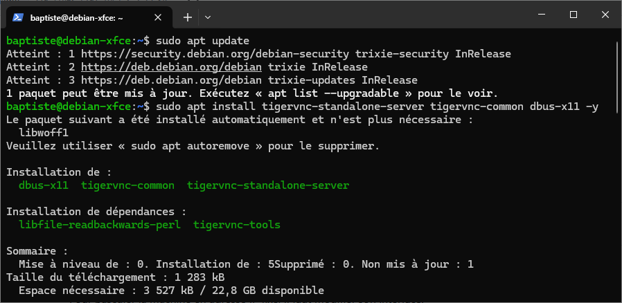
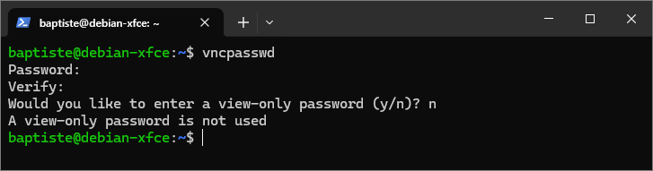
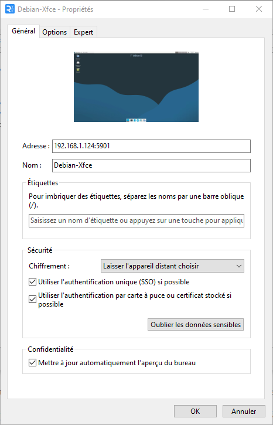
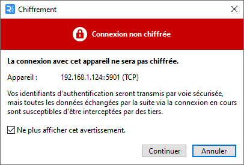
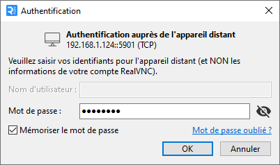
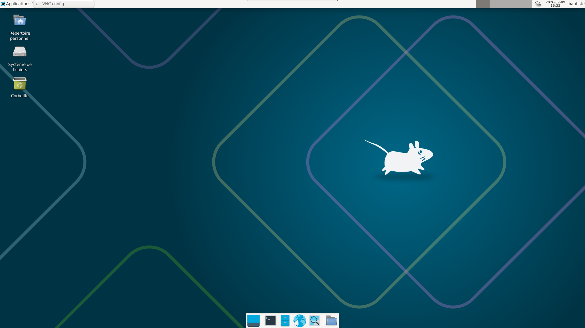

# Serveur TigerVNC (Xfce)

## 1 - Prérequis

- Un système Debian 12 ou 13 avec un <a href="https://www.xfce.org/" target="_blank" rel="noopener noreferrer">environnement de bureau Xfce</a>
- Une Connexion SSH

## 2 - Installation

### Installation des paquets
Mises à jour/installation des paquets de TigerVNC :
``` bash
sudo apt update
sudo apt install tigervnc-standalone-server tigervnc-common dbus-x11 -y
```
<figure markdown="span">
  { width="800" }
</figure>

## 3 - Configuration
### Définition d'un mot de passe VNC
Maintenant il faut définir un mot de passe avec la commande suivante :
``` bash
vncpasswd
```
!!! note
    Le maximum est de 8 caractères, il est également possible de définir un mot de passe de lecture seule

<figure markdown="span">
  { width="650" }
</figure>

### Configuration du lancement XFCE dans VNC
Création/édition du fichier `xstartup` :
``` bash
mkdir -p ~/.vnc
nano ~/.vnc/xstartup
```
Contenu du fichier `xstartup` :

``` bash
#!/bin/sh
unset SESSION_MANAGER
unset DBUS_SESSION_BUS_ADDRESS
exec startxfce4
```
Puis il faut rendre le fichier exécutable :

``` bash
chmod +x ~/.vnc/xstartup
```

### Test du serveur
Toujours dans le terminal, entrez la commande suivante :
``` bash
vncserver :1 -localhost no -geometry 1920x1080 -depth 24
```

??? note

    - `:1` correspond au port `5901` (:1 = 5900+1, :2 = 5900+2, etc...)
    - l'argument `-localhost no` autorise les connexions distantes
    - Ajustez `-geometry` à la résolution voulue
    

Dans le client VNC de votre choix, entrez l'adresse IP ainsi que l'identifiant (Nom de la machine par exemple).
<figure markdown="span">
  { width="450" }
</figure>

Accepter le message d'avertissement suivant :

<figure markdown="span">
  { width="450" }
</figure>

!!! warning "Attention"
    VNC n'est pas chiffré par défaut, pour un accès distant via internet vous pouvez utiliser un VPN héberger en local ou mettre en place un bastion comme <a href="https://guacamole.apache.org/" target="_blank" rel="noopener noreferrer">Apache Guacamole</a>.

Puis, entrez le mot de passe créé précédemment :

<figure markdown="span">
  { width="450" }
</figure>

Résultat dans VNC Viewer : 

<figure markdown="span">
  { width="800" }
</figure>

La commande suivante est pour arrêter le server VNC :
``` bash
vncserver -kill :1
```

### Création du service systemd
Création du fichier `/etc/systemd/system/vncserver@.service`
``` bash
sudo nano /etc/systemd/system/vncserver@.service
```
Contenu du fichier `vncserver@.service` :
``` ini
[Unit]
Description=Remote desktop service (VNC) - %i
After=syslog.target network.target

[Service]
Type=simple
User=NOM_D'UTILISATEUR
WorkingDirectory=/home/NOM_D'UTILISATEUR
PIDFile=/home/TON_USER/.vnc/%H:%i.pid
ExecStartPre=-/usr/bin/vncserver -kill :%i > /dev/null 2>&1
ExecStart=/usr/bin/vncserver :%i -localhost no -geometry 1920x1080 -depth 24 -fg
ExecStop=/usr/bin/vncserver -kill :%i

[Install]
WantedBy=multi-user.target
```
!!! note
    Pensez à remplacer `NOM_D'UTILISATEUR` par l'utilisateur de la session VNC
    
Activation/démarrage du service créé précédemment

```
sudo systemctl daemon-reload
sudo systemctl enable --now vncserver@1.service
```
