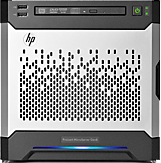
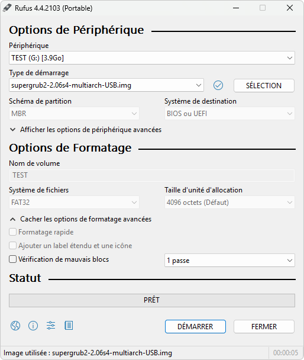
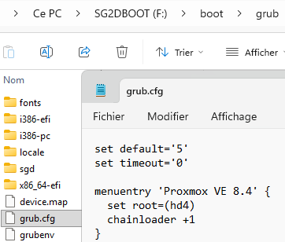

# GRUB sur clef USB
## __1 - Contexte__

{ align=right }
J'ai eu besoin d'utiliser cette technique car je possède un HP Microserver Gen 8 qui n'est pas conçu pour démarrer sur le SSD qui est situé dans la baie optique sans passer par le contrôleur RAID intégré.
## __2 - Installation de l'ISO__
Pour créer la clé USB, il faut utiliser "Super Grub2 Disk" qui est une ISO qui va partitionner la clé et créer tout les fichiers nécessaire au bon fonctionement de GRUB.
<div style="page-break-after: always;"></div>

[Télécharger](https://sourceforge.net/projects/supergrub2/files/2.06s4/super_grub2_disk_2.06s4/supergrub2-2.06s4-multiarch-USB.img.zip){ .md-button target=_blank } 

---

## __3 - Création de la clé USB__
Pour monter l'ISO sur la clé USB, il est possible d'utiliser [Rufus](https://rufus.ie/) ou [Balena Htcher](https://etcher.balena.io/).
<div style="page-break-after: always;"></div>
Exemple avec Rufus :
<figure markdown="span">
  { width="600" }
</figure>

## __4 - Configuration du GRUB__
Pour modifier le GRUB, il faut éditer le fichier "grub.cfg" présent dans la clé USB (`F:\boot\grub`) puis remplacer avec le contenu suivant :

```
set default='5'
set timeout='0'
 
menuentry 'Proxmox VE 8.4' {
  set root=(hd4)
  chainloader +1
}
```

<figure markdown="span">
  { width="450" }
</figure>
il vous faut ensuite modifier le nom de la partition sur laquelle vous voulez démarrer (exemple "hd4" "hd3,msdos1" etc..)

!!! note "Information importante"
    si vous n'arrivez pas à démarrer sur votre partition mais que votre machine accède au GRUB de la clé taper "c" et faite la commande "list", cela vous aidera pour repérer toutes les partitions présente. Il ne vous restera plus qu'à les tester une par une.

---

## __5 - Sources__

- <a href="https://www.bastelbunker.de/hp-microserver-gen8-booten-von-den-odd-port/" target="_blank" rel="noopener noreferrer">bastelbunker</a>
- <a href="https://www.linuxserver.io/blog/2015-03-24-setting-up-a-linux-home-server-using-the-hp-proliant-microserver-gen8-g1610t-3" target="_blank" rel="noopener noreferrer">linuxserver</a>

---

