# FOG 

<a href="https://fogproject.org/" target="_blank" rel="noopener noreferrer">FOG :fontawesome-solid-arrow-up-right-from-square:</a> (Free and Open-source Ghost) est une solution libre de déploiement et de clonage de postes en réseau.

## 1 - Prérequis

- Un __serveur Debian__ 12/13 [:fontawesome-solid-arrow-right: Configuration de base](/linux/debian/debian/#configuration-de-base)
- Un __Serveur DHCP__ (si vous ne souhaitez pas utiliser celui de FOG) [:fontawesome-solid-arrow-right: ISC-DHCP](/linux/isc-dhcp/#isc-dhcp)

## 2 - Installation de FOG

### Installation/décompression du package

```
cd /home
```
```
wget https://github.com/FOGProject/fogproject/archive/stable.tar.gz
```
```
tar -xzvf stable.tar.gz
```

### Installation de FOG

Lancement de l'instalateur :

```
cd fogproject-stable/bin
```
```
./installfog.sh
```

Sélectionner votre distribution Linux :

<figure markdown="span">
  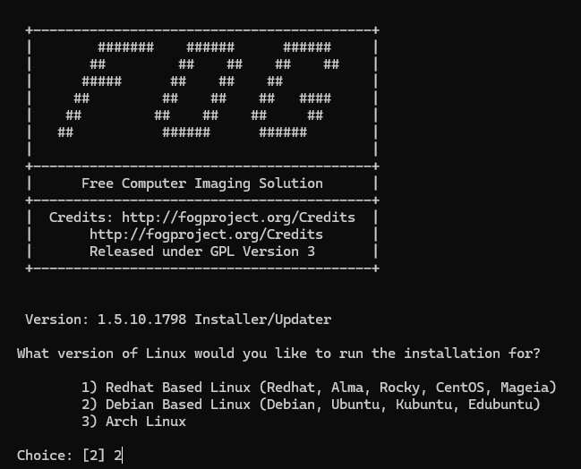{ width="700" }
</figure>

Sélectionner `N` pour une installation normale de FOG :

<figure markdown="span">
  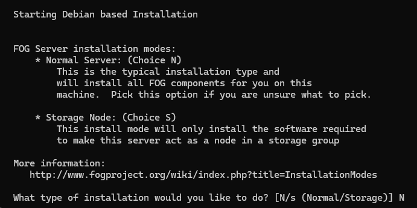{ width="700" }
</figure>

Sélectionner `N` si vous ne souhaitais pas configurer votre carte réseau :

<figure markdown="span">
  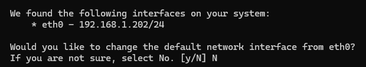{ width="700" }
</figure>

Configuration du serveur DHCP de FOG :

!!! info "Information"
    Si vous ne souhaitez pas utiliser le server DHCP de FOG, sélectionner `N` à toute les questions suivante.

<figure markdown="span">
  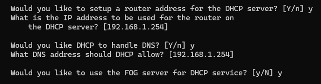{ width="700" }
</figure>

Sélectionner `Y` afin de pouvoir mettre en francais l'interface web :

<figure markdown="span">
  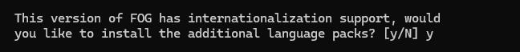{ width="700" }
</figure>

Sélectionner `N` si vous ne souhaitais pas avtiver le protocle HTTPS pour l'interface web :

<figure markdown="span">
  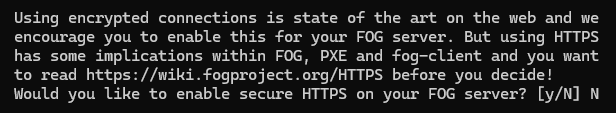{ width="700" }
</figure>

Sommaire de la configuration éfectué précedement :

<figure markdown="span">
  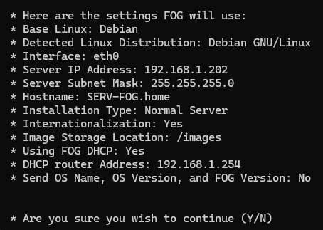{ width="500" }
</figure>

Pendant l'installation, il faut se connecter à l'interface web de fog :

<figure markdown="span">
  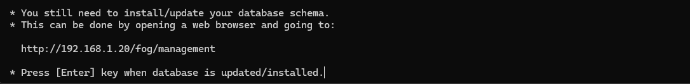{ width="700" }
</figure>

```
http://<adresse_serv_fog>/fog/management
```
puis, il faut sélectionner `Install/Update Now` afin de finaliser l'installation de la base de donné.

<figure markdown="span">
  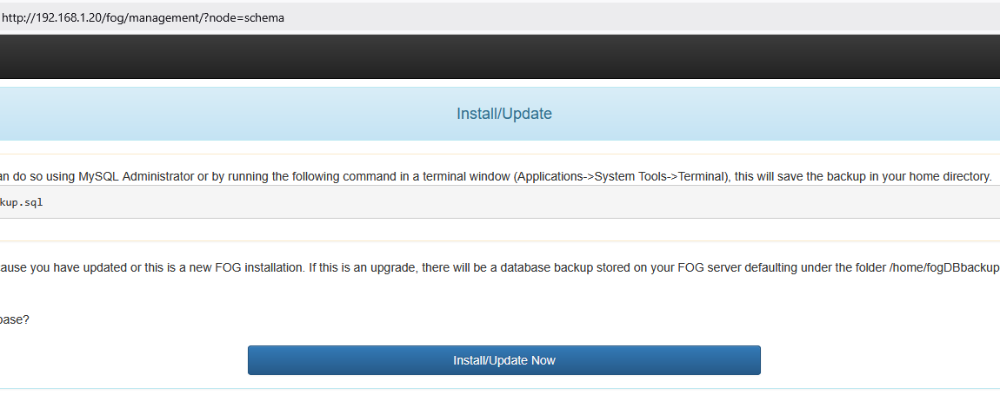{ width="800" }
</figure>

Une fois redirigé sur la page de conexion, il faut revenir dans votre terminal et faire la touche `Entrée`.

<figure markdown="span">
  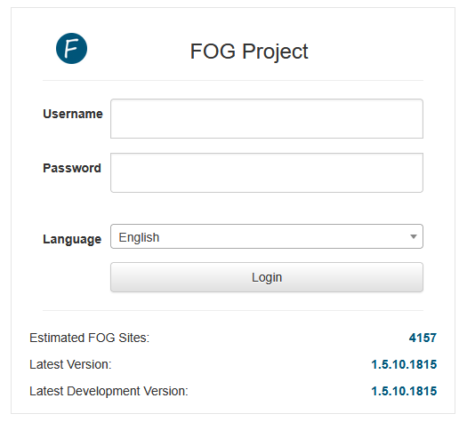{ width="500" }
</figure>

Une fois l'installation terminé, il reste plus qu'a se connecter avec les identifiants suivant :

- Username : `fog`
- Password : `password`

<figure markdown="span">
  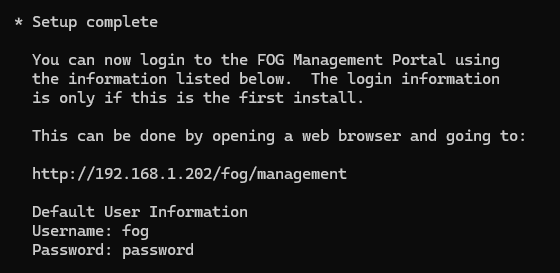{ width="500" }
</figure>

## 3 - Configuration de FOG

### Création d'un utilisateur
Pour créer un nouvelle utilisateur, il faut se diriger dans l'onglet `User > Create New User`.

<figure markdown="span">
  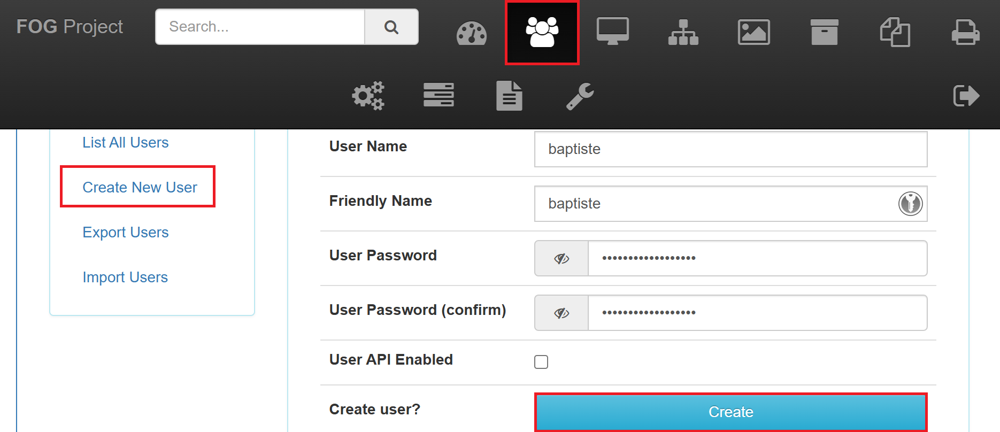{ width="700" }
</figure>

### Enregistrement d'une machine
Pour enregistrer une nouvelle machine, il vous sufit de démarer en réseau (Généralement `F12`) et de sélectionner `Quick registration and inventory`.  

<figure markdown="span">
  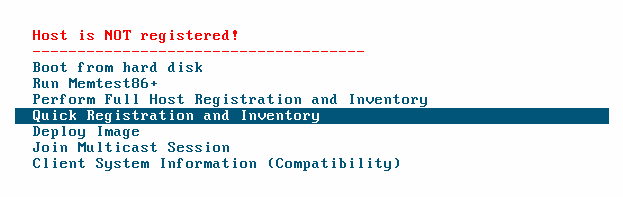{ width="700" }
</figure>

Une fois que la machine à redémarer vous pouvez l'éteindre. 

Pour enregistrer l'image, il vous faut aller dans l'onglet `Image Management -> Create New Image`. Puis modifier les valeurs selon le système d'exploitation.

<figure markdown="span">
  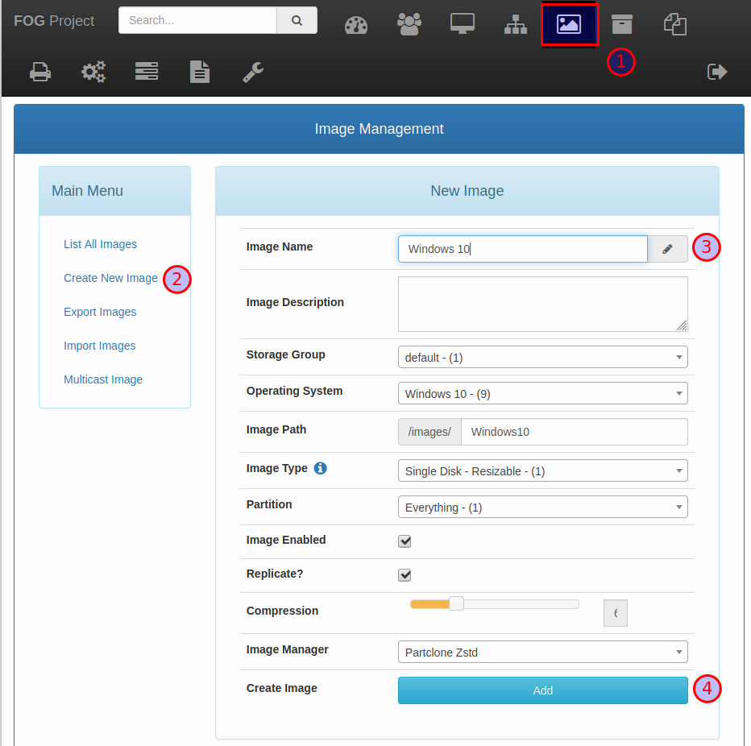{ width="600" }
</figure>

Ensuite, il faut associer l'image créer à la machine :

<figure markdown="span">
  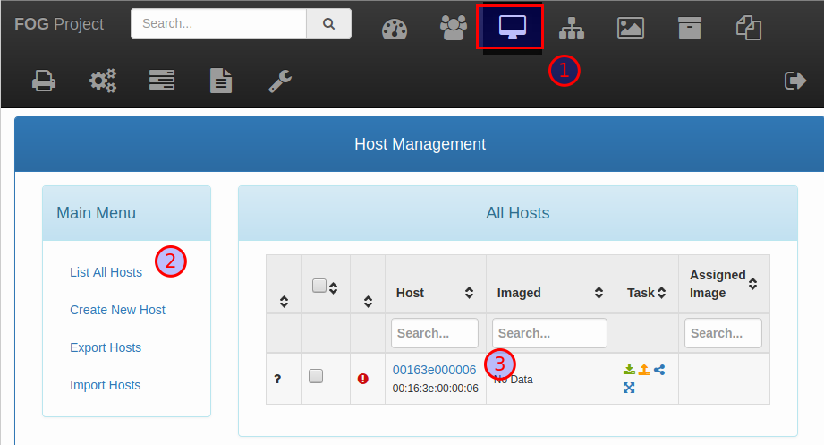{ width="600" }
</figure>
<figure markdown="span">
  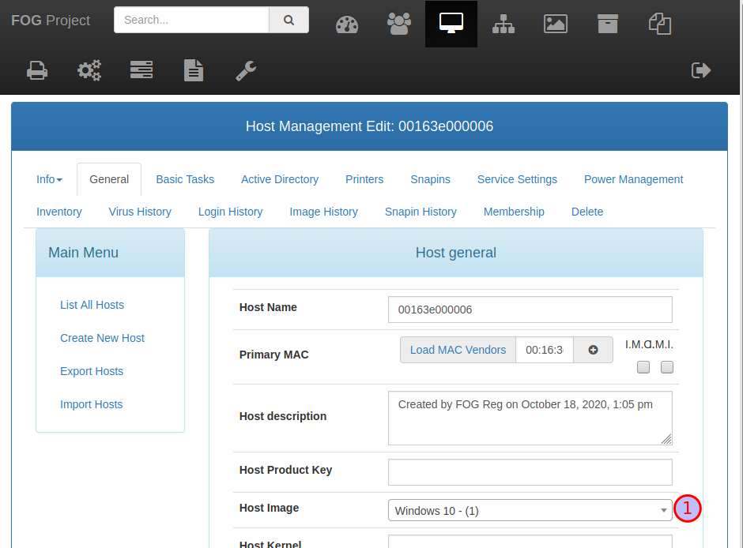{ width="600" }
</figure>

## 4 - Sources

- <a href="https://docs.fogproject.org/en/latest/" target="_blank" rel="noopener noreferrer">docs.fogproject.org</a>
- <a href="https://docs.fogproject.org/en/1.5.9/" target="_blank" rel="noopener noreferrer">docs.fogproject.org (old)</a>
---
