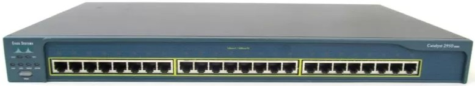

# Switch 2950

<figure markdown="span">
  { width="650" }
</figure>

## 1 - Accès à l’interface de configuration
1 - Brancher le port console sur le port série de votre appareil CISCO,
<div style="page-break-after: always;"></div>

2 - Sur votre ordinateur lancer/installer <a href="https://www.chiark.greenend.org.uk/~sgtatham/putty/latest.html" target="_blank" rel="noopener noreferrer">Putty</a> avec la configuration suivante :

Diriger la connexion vers le port COM choisi en 1,

- Choisir un débit de 9600 bit/s
- 8 bits de données
- Pas de parité
- 1 bit de stop

## 2 - Configuration du Switch

^^__Passage en mode privilégié :__^^
<div style="page-break-after: always;"></div>
```
Enable
```
pour entrer dans le mode privilégié. La validation de cette commande entraîne
souvent la demande d’un mot de passe.

## 3 - Visualisation des informations de configuration
### Commandes courantes
<div style="page-break-after: always;"></div>
Lister la configuration en cours d’utilisation du switch :
```
show running-config
```

<div style="page-break-after: always;"></div>

Lister la configuration au démarrage du switch :
```
show startup-config
```
<div style="page-break-after: always;"></div>

Visualiser les VLANs présents sur le switch ainsi que les ports membres de chaque VLAN :
```
show vlan
```
<div style="page-break-after: always;"></div>
Lister toutes les options possibles de la commande show :
```
sh ?
```

## 4 - Sauvegarde et restauration des fichiers de configuration

On peut utiliser la commande copy pour copier une configuration en mémoire ou récupérer une configuration à partir de la mémoire ou d’ailleurs.

Copier la configuration en train de fonctionner vers la mémoire :
```
Copy running-config startup-config
```

<div style="page-break-after: always;"></div>

Copier de la mémoire la configuration qui va fonctionner :
```
Copy startup-config running-config
```
<div style="page-break-after: always;"></div>
Copier un fichier d’un serveur tftp vers la mémoire :
```
Copy tftp startup-config
```
<div style="page-break-after: always;"></div>

Sauvegarder la configuration présente dans la mémoire vers un serveur tftp.
```
Copy startup-config tftp
```
## 5 - Modification de la configuration
Pour modifier la configuration, taper la commande : 
```
config terminal
```
À ce niveau on peut taper des commandes valables pour l’ensemble du switch par exemple :
<div style="page-break-after: always;"></div>

```
hostname "nom_du_switch" 
```
Cette commande permet de donner un nom au switch. Par exemple : __hostname router1__

## 6 - Adressage IP
Chaque Vlan sur le switch est considéré comme une « interface » du switch que l’on pourra configurer au niveau IP.
Par défaut le switch est constitué d’un seul VLAN.

<div style="page-break-after: always;"></div>
Rentrer dans le mode de configuration de l’interface vlan1 :
```
Interface vlan1
```

Lorsque l’on a configuré une interface et que l’on veut retourner au niveau de configuration supérieur
(pour pouvoir accéder à la configuration d’une autre interface par exemple) il suffit de taper la
commande __exit__.
<div style="page-break-after: always;"></div>

Les commandes les plus utilisées dans la configuration des interfaces sont les suivantes :

```
Ip address "adresse_ip_de_l’interface" "masque_de_sous_réseau" 
```

_Exemple : __ip address 172.168.16.1 255.255.240.0___

Indiquer que cette interface ne doit pas être inactive :
```
No shutdown
```  

## 7 -  Les VLANs

Rentrer dans le menu de configuration :
```
Configure terminal
```
Créer le VLAN :
```
Vlan X
```
_Exemple : __Vlan 10___
!!! info "Information"
    X étant le N° du vlan à créer ou à configurer. Un vlan par défaut existe, il s’agit du __N°1__.

Nommer ce vlan :
```
Name "Nom_du_vlan"
```
_Exemple : __Name Vlan10___

Ensuite il faut affecter les ports aux vlans :

### Aplication des VLANs sur un port en mode "TRUNK"
Le mode trunk permet de ==transmetre des données provenant ^^de plusieurs VLAN^^.==

<div style="page-break-after: always;"></div>
Exemple avec le port __N°1__ :

``` 
interface fa0/1
switchport mode trunk 
no shutdown
exit
```
!!! note "Information importante"
    Il est également possible de spécifier les VLAN car par défaut **toutes les VLANS peuvent passer sur un port trunk**.
    ```
    switchport trunk allowed vlan 20,30,99
    ```

### Aplication des VLAN sur un port en mode "ACCES"
Le mode acces permet de ==transmetre des données au sein ^^d'un même VLAN^^.==

<div style="page-break-after: always;"></div>

Exemple avec le port __N°2__ et le __VLAN 10__ :

``` 
interface fa0/2
switchport access vlan 10 
no shutdown
exit
``` 

## 8 - Configuration du SSH
- `hostname sw1` : Nom d'hôte
- `ip domain-name baptiste` : Nom de domaine
- `crypto key generate rsa` : Générer un certificat pour la connexion SSH (2048 bits)
``` 
ip ssh version 2
line vty 0 4
transport input ssh
login local
``` 
- `username baptiste password 123456` :
!!! warning "Attention"
    Ne pas oublier d'enregistrer la conf sur le switch.
    ```
    wr : pour écrire la configuration sur le switch
    ```
Commande pour se connecter en ssh depuis windows sur un équipement cisco :
```
ssh -oKexAlgorithms=+diffie-hellman-group1-sha1 -oHostKeyAlgorithms=+ssh-rsa -oPubkeyAcceptedAlgorithms=+ssh-rsa -oCiphers=+3des-cbc -oMACs=+hmac-sha1 nom_d_utilisateur@adresse_ip
```

## 9 - Remise à plat du switch
Commande de mise en configuration d’usine du switch :
```
write erase
delete flash:vlan.dat
reload
copy run start
``` 
