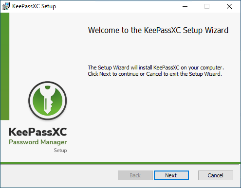
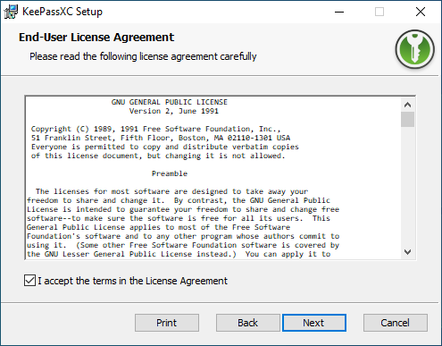
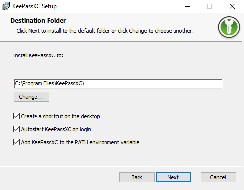
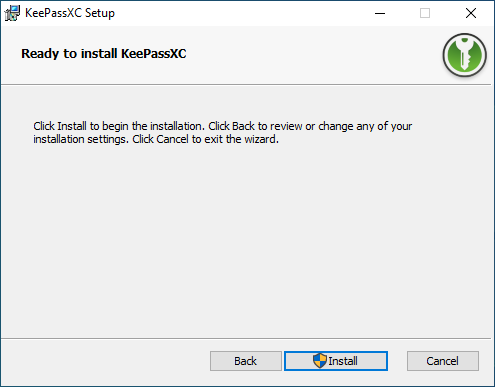
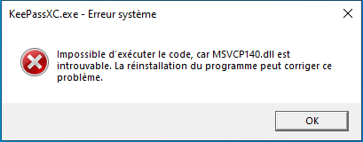

# KeePassXC
:material-calendar-blank: __23/09/2026__ - :material-note: _Tuto réalisé avec KeePassXC version 2.7.12_
## 1 - Présentation

<a href="https://keepassxc.org/" target="_blank" rel="noopener noreferrer">KeePassXC :fontawesome-solid-arrow-up-right-from-square:</a> est un gestionnaire de mots de passe gratuit et open source qui permet de stocker en toute sécurité vos identifiants, mots de passe et informations sensibles dans une base de données chiffrée.

## 2 - Installation

Lien de téléchargement de KeePassXC : <a href="https://keepassxc.org/download/" target="_blank" rel="noopener noreferrer">:fontawesome-solid-arrow-right: keepassxc.org/download/</a>

Pour commancer, il faut sélectionner "Next" :

<figure markdown="span">
  { width="500" }
</figure>

Cochez la case à gauche pour accepter la license, puis sélectionner une fois de plus "Next" :

<figure markdown="span">
  { width="500" }
</figure>

Cochez la case "Create a shortcut on the desktop" si vous souhaitez créer un raccourci sur le bureau :

<figure markdown="span">
  { width="500" }
</figure>

Pour finir sélectionner "Install" afin d'installer l'application :

<figure markdown="span">
  { width="500" }
</figure>

??? warning Erreur "MSVCP140.dll"

    Si au lancement de KeePassXC vous tomber sur ce message d'erreur :
   
    <figure markdown="span">
     { width="500" }
    </figure>