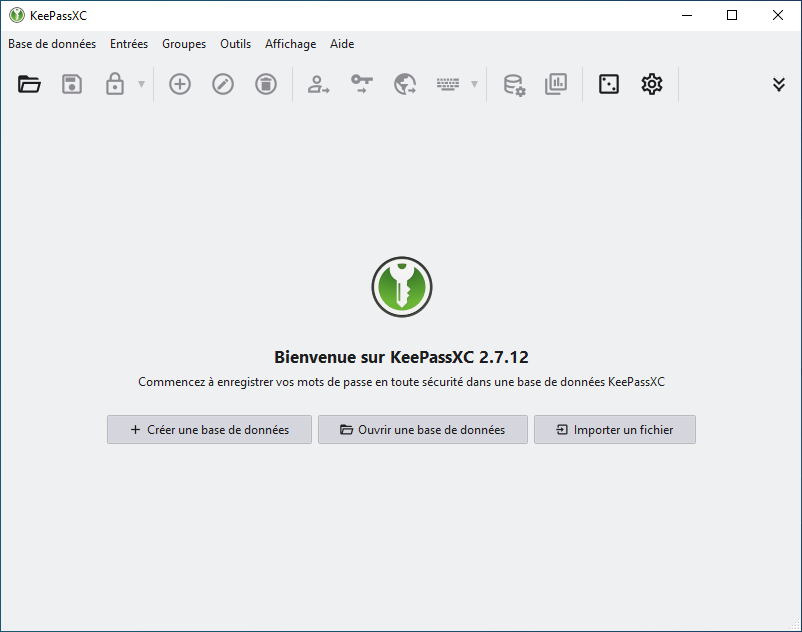
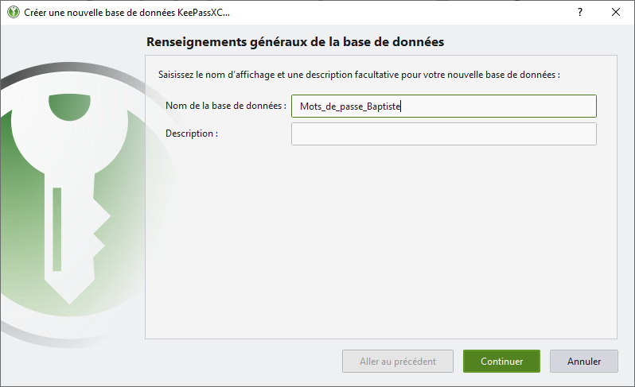
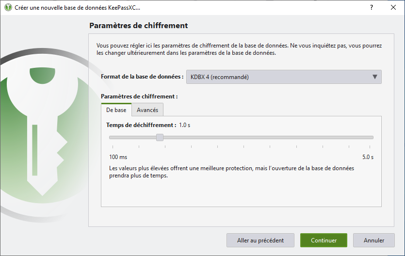
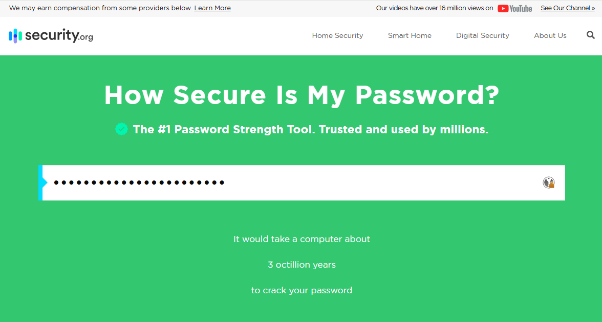
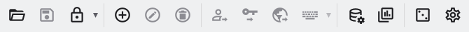
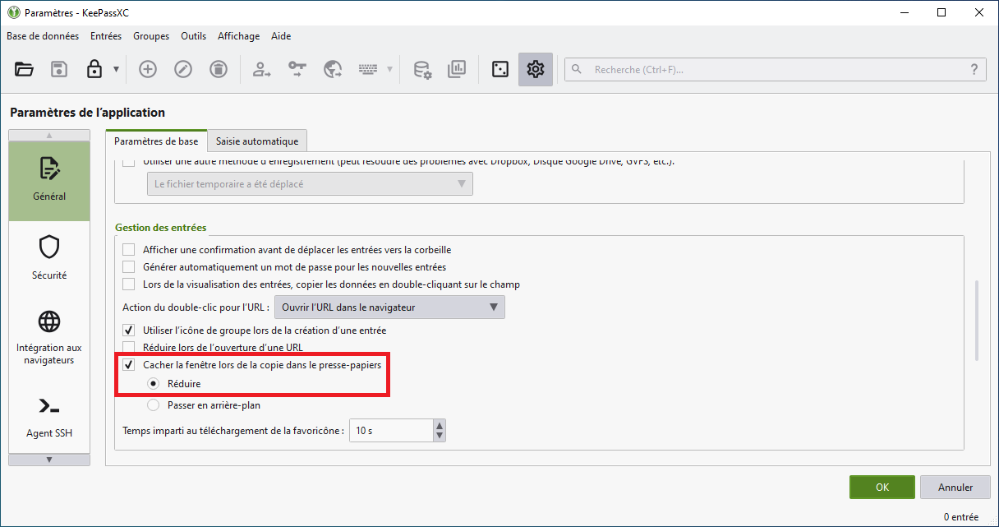
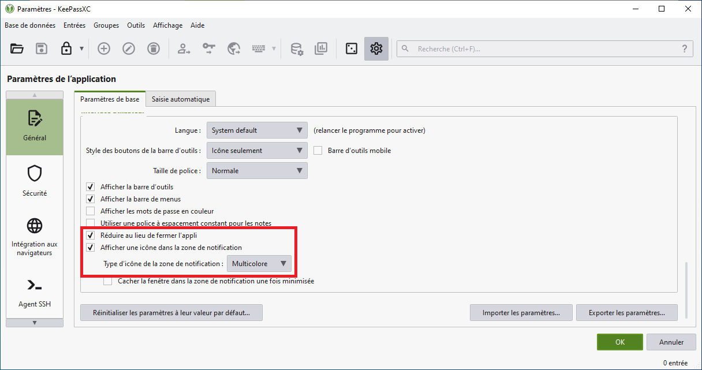

# KeePassXC
:material-calendar-blank: __23/09/2026__ - :material-note: _Tuto réalisé avec KeePassXC version 2.7.12_
## 1 - Présentation

<a href="https://keepassxc.org/" target="_blank" rel="noopener noreferrer">KeePassXC :fontawesome-solid-arrow-up-right-from-square:</a> est un gestionnaire de mots de passe gratuit et open source qui permet de stocker en toute sécurité vos identifiants, mots de passe et informations sensibles dans une base de données chiffrée.

## 2 - Installation

Lien de téléchargement de KeePassXC : <a href="https://keepassxc.org/download/" target="_blank" rel="noopener noreferrer">:fontawesome-solid-arrow-right: keepassxc.org/download/</a>

Pour commancer, il faut sélectionner __Next__ :

<figure markdown="span">
  { width="600" }
</figure>

Cochez la case à gauche pour accepter la license, puis sélectionner une fois de plus __Next__ :

<figure markdown="span">
  { width="600" }
</figure>

Cochez la case __Create a shortcut on the desktop__ si vous souhaitez créer un raccourci sur le bureau :

<figure markdown="span">
  { width="600" }
</figure>

Pour finir sélectionner __Install__ afin d'installer l'application :

<figure markdown="span">
  { width="600" }
</figure>

??? warning "Erreur MSVCP140.dll"

    Si au lancement de KeePassXC, l'erreur suivante apparaît à l'écran :
   
    <figure markdown="span">
     { width="350" }
    </figure>

    Il faut installer le package suivant : <a href="https://learn.microsoft.com/en-us/cpp/windows/latest-supported-vc-redist?view=msvc-170#visual-c-v14-redistributable" target="_blank" rel="noopener noreferrer">:fontawesome-solid-arrow-right: learn.microsoft.com/en-us/cpp/windows/latest-supported-vc-redist</a>

## 3 - Configuration

### Création d'une base de données

Après avoir démarrer KeePassXC, sur l'écran d'acceuil, sélectionner __Créer une base de données__ :

<figure markdown="span">
  { width="600" }
</figure>

Ensuite, donnez lui un nom : (ex : Mots_de_passe_Baptiste)

<figure markdown="span">
  { width="600" }
</figure>

Pour le chiffremment de la base de données, laisser par défaut et sélectionnez __Continuer__ :

<figure markdown="span">
  { width="600" }
</figure>

Maintenant, saisissez un mots de passe __trés fort__ :

??? note "Recommandation"

    Vous pouvez tester la solidité de votre mot de passe sur le site suivant : <a href="https://www.security.org/how-secure-is-my-password/" target="_blank" rel="noopener noreferrer">:fontawesome-solid-arrow-right: security.org/how-secure-is-my-password/</a>
    <figure markdown="span">
      { width="550" }
    </figure>
    
<figure markdown="span">
  { width="600" }
</figure>

### Paramétrage de KeePassXC

Sélectionner l'engrenage situé à droite dans le panneau horizontal : 

<figure markdown="span">
  { width="800" }
</figure>

Dans l'onglet __Géneral__ : 

Cochez la case : 

- __Cacher la fenêtre lors de la copie dans le presse-papier__ 
- __Réduire__ 

<figure markdown="span">
  { width="600" }
</figure>

Cochez également : 

- __Réduire au lieu de fermer l'appli__ 
- __Afficher une icône dans la zone de notification__ et sélectionner __Multicolore__

<figure markdown="span">
  { width="600" }
</figure>