# Configuration

## Création d'une tache de sauvegarde

Tout d'abord, il faut se rendre dans l'onglet : `Centre de données > Sauvegarde` puis `Ajouter`.
<div style="page-break-after: always;"></div>
Puis ajouter :

- Noeud `proliant`
- Stockage `backups`
- Planification `mon 01:00` (Sauvegarde le Lundi à 1h du matin)
- Mode `Stopper`

<figure markdown="span">
  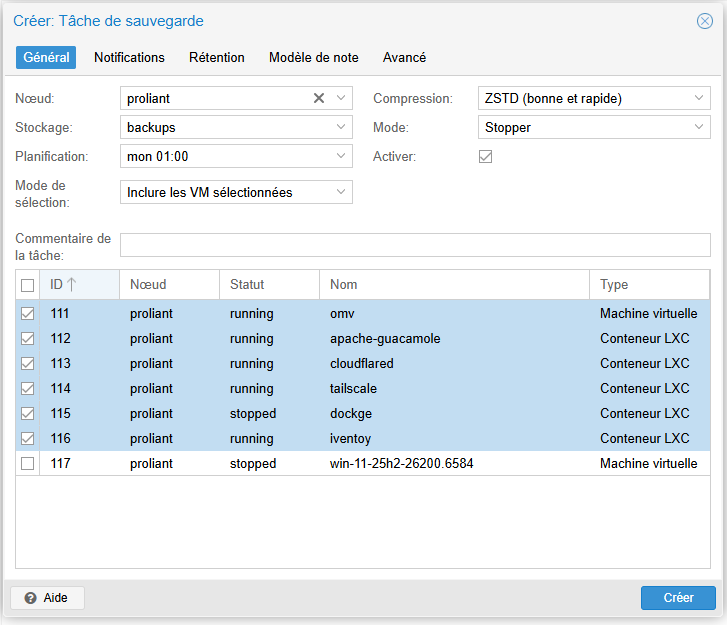{ width="700" }
</figure>

Laisser les notifications par défaut :

<figure markdown="span">
  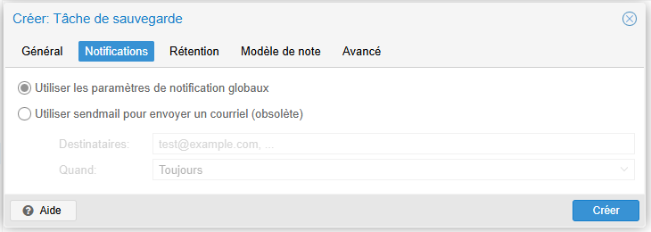{ width="700" }
</figure>

Réglage de la rétantion des sauvegardes sur `2 semaines` :

<figure markdown="span">
  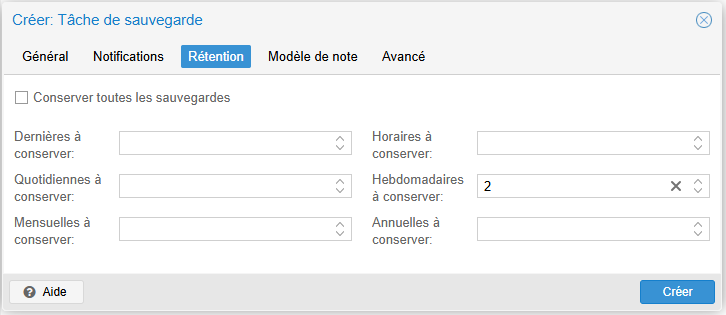{ width="700" }
</figure>

Ajout d'une note inclus dans la sauvegarde :

<figure markdown="span">
  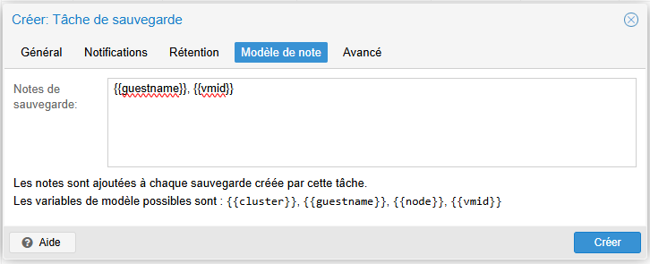{ width="700" }
</figure>

Résumé de la tache :

<figure markdown="span">
  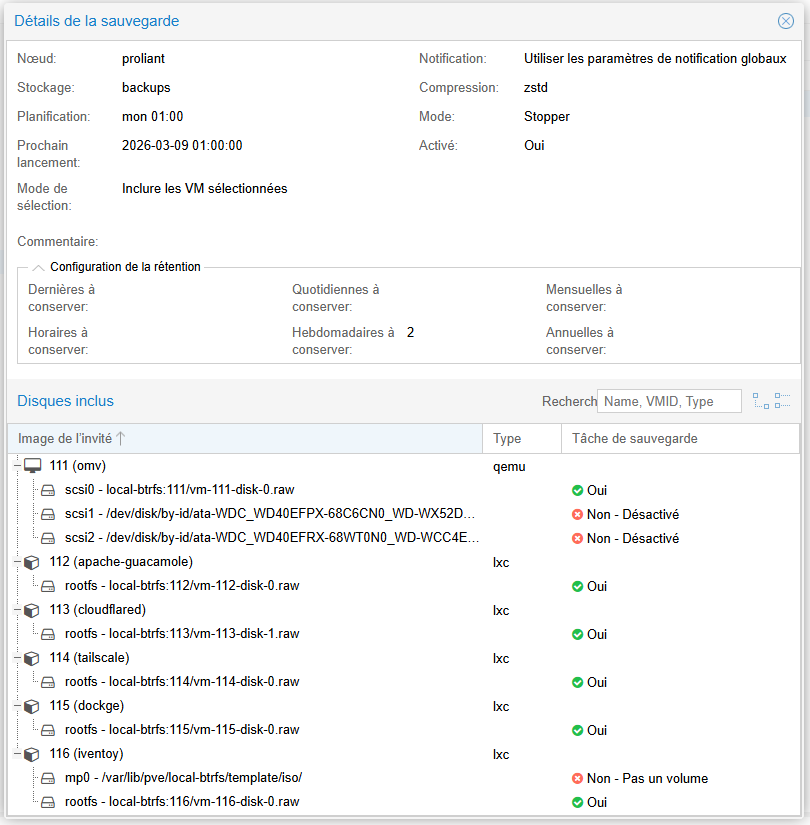{ width="700" }
</figure>

---

## Mise en place des notifications avec un Webhook Discord
### Désactivation de l'envoi de mail par défaut
Tout d'abord, il faut se rendre dans l'onglet : `Centre de données > Notifications` puis éditer la règle par défaut `mail-to-root` et décocher `Activer` afin de ne plus utiliser l'envoi de mail classique.
<figure markdown="span">
  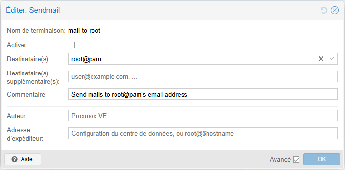{ width="700" }
</figure>

---

### Création d'un Webhook sur Discord
Pour créer un Webhook sur Discord il vous sufit de vous rendre sur votre serveur puis dans `Paramètres du serveur > Intérgrations > Webhooks` puis `Nouveau webhook`, vous pouvez ensuite modifier la photo, changer le nom et affecter un salon dans lequel les notifications seront reçus. Il vous sufit maintenant de sélectionner `Copier l'URL du webhook` car nous allons en avoir besoin pour la suite.

<figure markdown="span">
  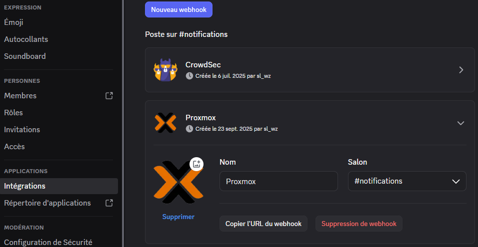{ width="700" }
</figure>

---

### Ajout d'une cible de notification avec un Webhook Discord
Maintenant il faut ajouter une nouvelle cible de notification dans Proxmox : `Centre de données > Notifications` puis `Ajouter > Webhook`
<div style="page-break-after: always;"></div>

puis remplir les élements suivants :

- Nom de la terminaison `Discord`
- Méthode et URL `POST` puis l'URL du webhook crée à l'étape précedante 
- Ajouter les en-têtes suivantes :
    - `Content-Type application/json`
    - `Accept application/json`
- Ajouter le corps suivant et changer la valeur `<adresse_du_serv_proxmox>` :
```
{"content":null,"embeds":[{"title":"🔔 {{ escape title }}","url": "<adresse_du_serv_proxmox>","description":"```{{ escape message }}```","color": {{#if (eq severity "error")}}16711680{{else if (eq severity "warning")}}16753920{{else}}5763719{{/if}},"footer":{"text":"Proxmox"}}],"attachments":[]}

```
- Secrets 
    - `token` puis la partie de l'URL après `https://discord.com/api/webhooks/`

!!! warning "Attention"
    Si vous recevez une erreur quelconque faite bien attention de ne pas laisser d'espace

<figure markdown="span">
  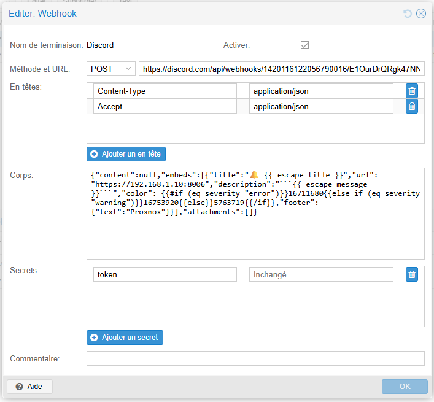{ width="700" }
</figure>

Pour finir il ne reste plus qu'a modifier la partie `Correspondances de notification`, éditer la règle par défaut `default-matcher`.

Ajout des différents types de gravité :

<figure markdown="span">
  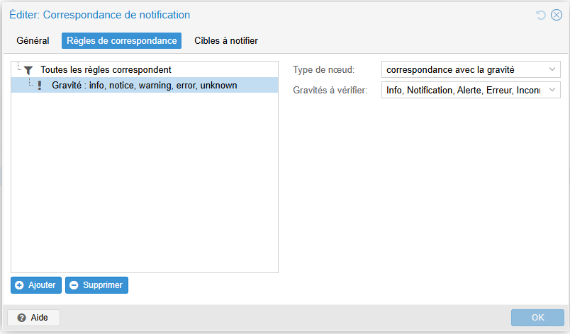{ width="700" }
</figure>

Il faut également décocher la cible `mail-to-root` et cocher la cible que l'on vient de créer :

<figure markdown="span">
  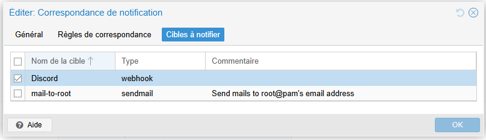{ width="700" }
</figure>

Résultat sur Discord :

<figure markdown="span">
  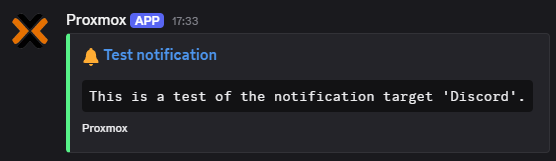{ width="700" }
</figure>

---

## Installation de pilote AMS
Les serveurs HPE ProLiant disposent d'un logiciel complémentaire appelé Agentless Management Service qui permet de faire la liaison entre le système d'exploitation et la consôle d'administration ILO. Et qui par exemple, permet de réduire la vitesse des ventilateurs, voir la température du CPU et autres.
<div style="page-break-after: always;"></div>
Téléchargement du package :

```
wget https://downloads.linux.hpe.com/SDR/repo/mcp/debian/pool/non-free/hp-ams_2.6.2-2551.13_amd64.deb
```
installation du package :

```
dpkg -i hp-ams_2.6.2-2551.13_amd64.deb
```
!!! info "Information"
    Vous pouvez Supprimez le fichier .deb une fois installé si vous ne souhaitez pas le conserver :
    ```
    rm hp-ams_2.6.2-2551.13_amd64.deb
    ```
Résultat :
<figure markdown="span">
  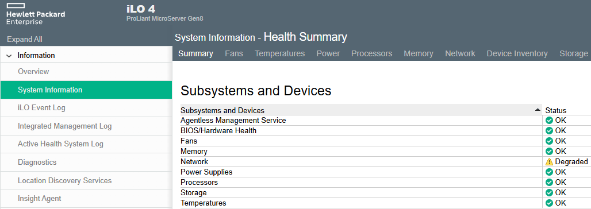{ width="800" }
</figure>

---
