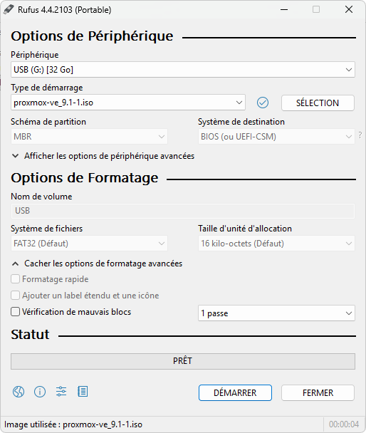
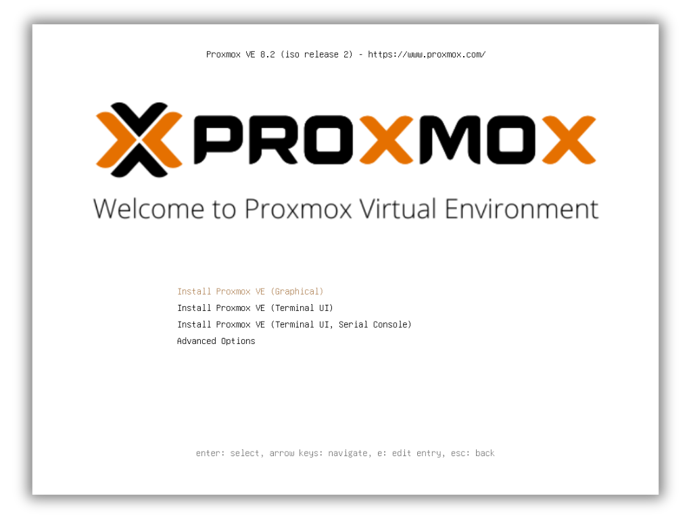

# Installation de Proxmox

## 1 - Prérequis

!!! note "Information Importante"
    Ces exigences minimales sont données à titre indicatif uniquement et ne doivent pas être utilisées en production.

- Processeur : 64 bits (Intel 64 ou AMD64)

- Processeur/carte mère compatible Intel VT/AMD-V pour une prise en charge complète de la virtualisation KVM

- RAM : 1 Go de RAM, plus la RAM supplémentaire nécessaire pour les invités

- Disque dur

- Une carte réseau (NIC)

---

## 2 - Préparation du support

Téléchargez l'image ISO du programme d'installation depuis : https://www.proxmox.com/en/downloads/proxmox-virtual-environment/iso

Pour monter l'ISO sur la clé USB, il est possible d'utiliser [Rufus](https://rufus.ie/) ou [Balena Htcher](https://etcher.balena.io/).

Exemple avec Rufus :
<figure markdown="span">
  { width="500" }
</figure>

---

## 3 - Installation

Veuillez insérer le support d'installation préparé et démarrer à partir de celui-ci.

Ensuite sélectionner la première option :
<figure markdown="span">
  { width="800" }
</figure>
