# Serveur 2025

## 1 - Installation des images ISO sur proxmox

Pour télecharger une ISO dans proxmox il faut se rendre dans votre `point de montage (local) ou (local-btrfs) > Images ISO > Télécharger depuis l'URL`

<figure markdown="span">
  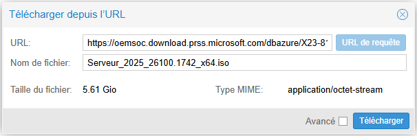{ width="700" }
</figure>

Lien de téléchargement de l'ISO sur le portail OEM officiel de Microsoft :

```
https://oemsoc.download.prss.microsoft.com/dbazure/X23-81959_26100.1742.240906-0331.ge_release_svc_refresh_SERVER_OEMRET_x64FRE_fr-fr.iso_b70a976b-4427-480d-851f-3001eed584e9?t=fc8c2647-683b-42e9-a6ef-1e46e0fed04c&P1=102816956393&P2=601&P3=2&P4=pKJK%2fJ3fYB2jURh3KiMOUSg%2bi4usxJt8PBFv7XiZnGEKk96Tq%2b6PFZGZqEBllMReIqbt2pKP4bP9%2bVHnU5Ur6HPLxG0SCddY5MWr1V0R40DmhSBPS3D%2bAH0oH9Yzg%2bJiFSa8h7SG4fT5F%2fs9grCncSaSVz4enUfiIAjFi3dmaIyRE8JhUcnqgHUq915tWaz%2fAv3Gevlqcg%2f2MlGws0DbDWBj5NeJHWUwoa1sGXpX6Sxu%2bfX%2bPy8qO%2bn1vjxezO3twFX1O13iXVh7wDFLBAgSaS6tAX8z3jIogzo3TGRK%2bohxywtgwUSwrIISJWvI3Q6UPdibuxu5wBZgFtVam8bw6A%3d%3d
```

!!! info "Information"
    Liens alternatifs :
    <a href="https://massgrave.dev/windows-server-links" target="_blank" rel="noopener noreferrer">massgrave.dev</a> / <a href="https://uup.rg-adguard.net/" target="_blank" rel="noopener noreferrer">uup.rg-adguard.net</a> / <a href="https://msdl.gravesoft.dev/" target="_blank" rel="noopener noreferrer">msdl.gravesoft.dev</a>

### Pilotes VirtIO

Effectuez la même opération pour les pilotes VirtIO.

```
https://fedorapeople.org/groups/virt/virtio-win/direct-downloads/archive-virtio/virtio-win-0.1.285-1/virtio-win-0.1.285.iso
```

Liens des pilotes VirtIO :
<a href="https://fedorapeople.org/groups/virt/virtio-win/direct-downloads/archive-virtio/?C=M;O=D" target="_blank" rel="noopener noreferrer">fedorapeople.org</a>

## 2 - Création de la machine virtuelle

Dans la barre superieur à droite sur l'interface web de proxmox, séléctionner `Créer une VM`

<figure markdown="span">
  { width="900" }
</figure>

Changement du VM ID et ajout d'un nom.

<figure markdown="span">
  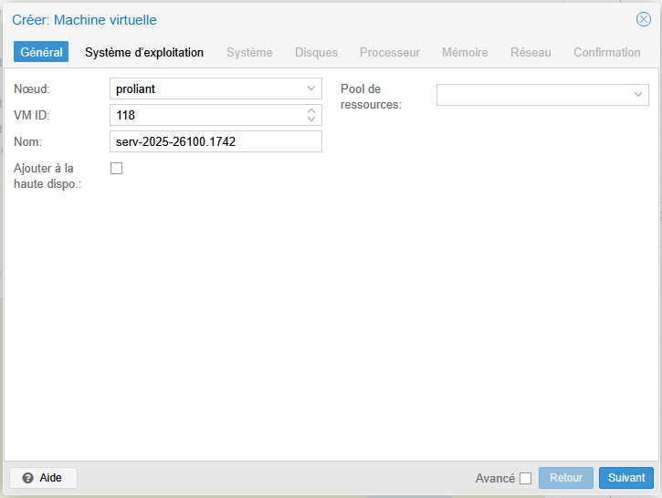{ width="700" }
</figure>

Sélectionner l'image ISO, ensuite dans type :

 - `Microsoft Windows` 
 - `11/2022/2025` 

Puis cochez : `Ajouter un périphérique contenant les pilotes VirtIO` et ajoutez l'ISO.

<figure markdown="span">
  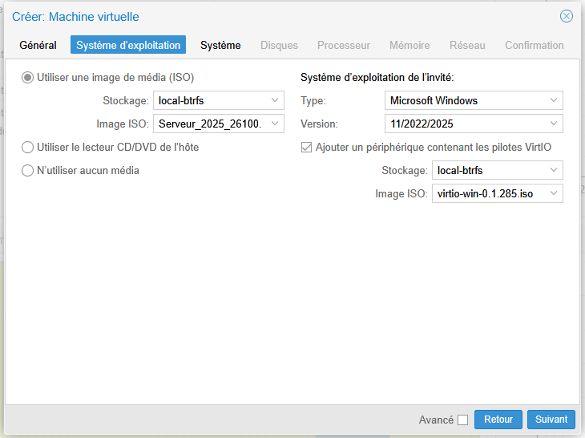{ width="700" }
</figure>

Ajoutez les modules `EFI` puis `TPM` ainsi que le stockage, puis cochez `Agent QEMU`.

<figure markdown="span">
  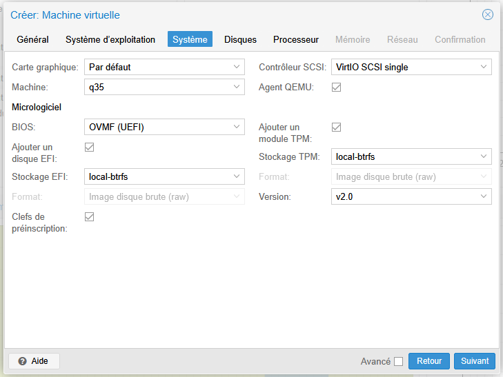{ width="700" }
</figure>

Sélectionner l'emplacement de stockage ainsi que la taille, pour le cache : `Write back` et cochez `Abandonner`.

<figure markdown="span">
  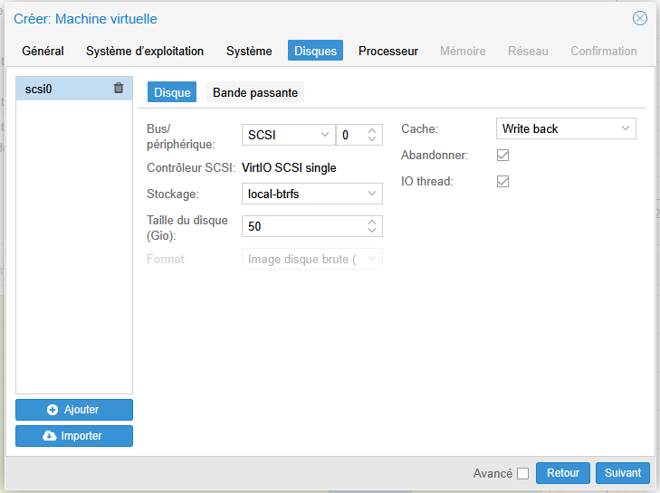{ width="700" }
</figure>

Sélectionner le nombre de coeurs en mode `host` puis la quantité mémoire.

<figure markdown="span">
  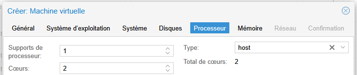{ width="700" }
</figure>
<figure markdown="span">
  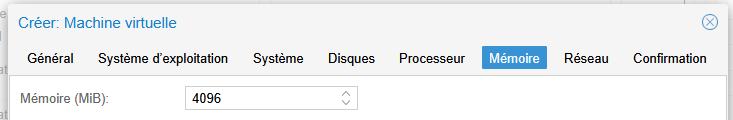{ width="700" }
</figure>

Sélectionner votre carte réseau avec le modèle : `VirtIO (paravirtualisé)`.

<figure markdown="span">
  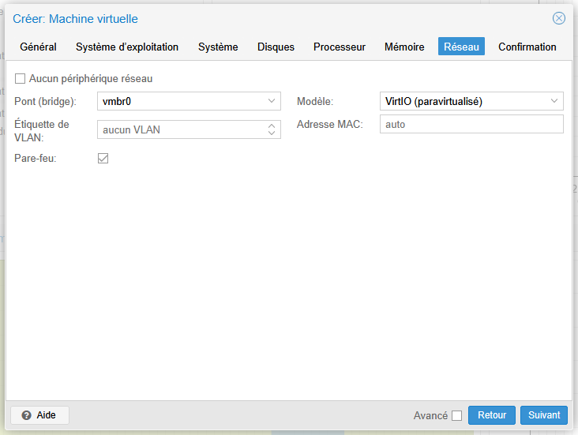{ width="700" }
</figure>

Puis confirmez.

## 3 - Installation de Windows serveur 2025

Pour le début, c'est une installation classique il faut accepter les conditions d'utilisation, selectionner Windows serveur 2025 experiance de bureau.
<div style="page-break-after: always;"></div>
à l'étape du stockage, il faut sélectionner `Load Driver`
<figure markdown="span">
  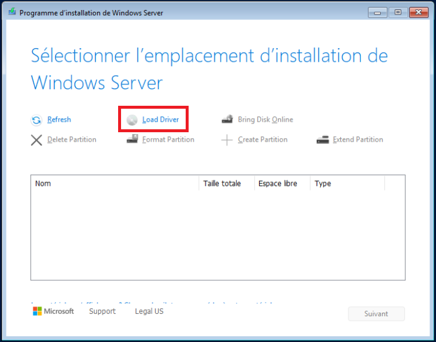{ width="700" }
</figure>
ensuite, sélectionner l'ISO ou se trouve les drivers `(D:) virtio-win-0.1.285`, puis installer le pilote.
<figure markdown="span">
  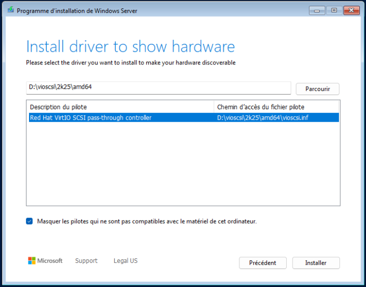{ width="700" }
</figure>
Vous pouvez enfin sélectionner et partitionner vos disques.
<figure markdown="span">
  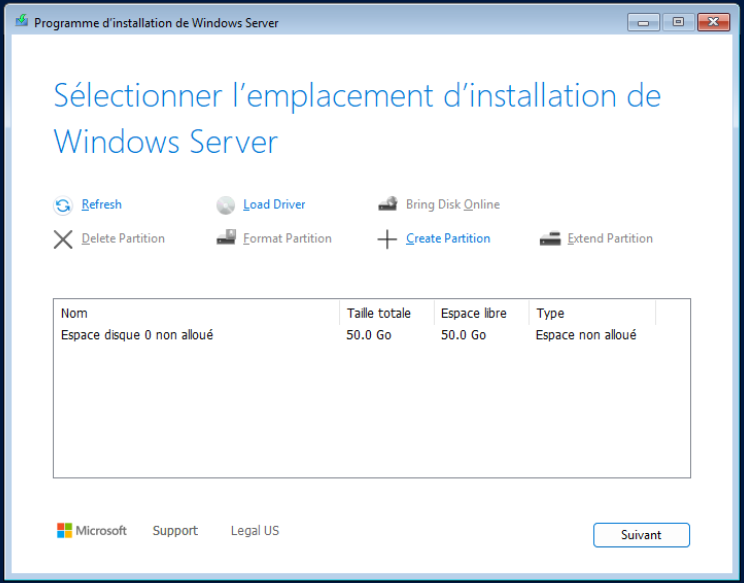{ width="700" }
</figure>

### Installation des pilotes

Aprés l'installation, il manque quelques pilote :
<figure markdown="span">
  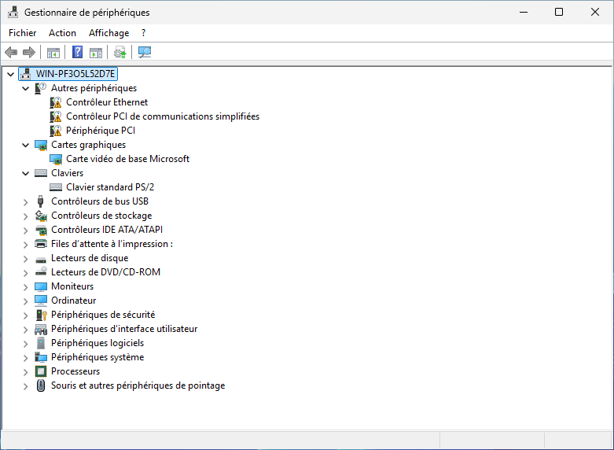{ width="700" }
</figure>
Pour les installer, il vous sufit d'executer `virtio-win-gt-x64.exe` et `virtio-win-guest-tools.exe`
<figure markdown="span">
  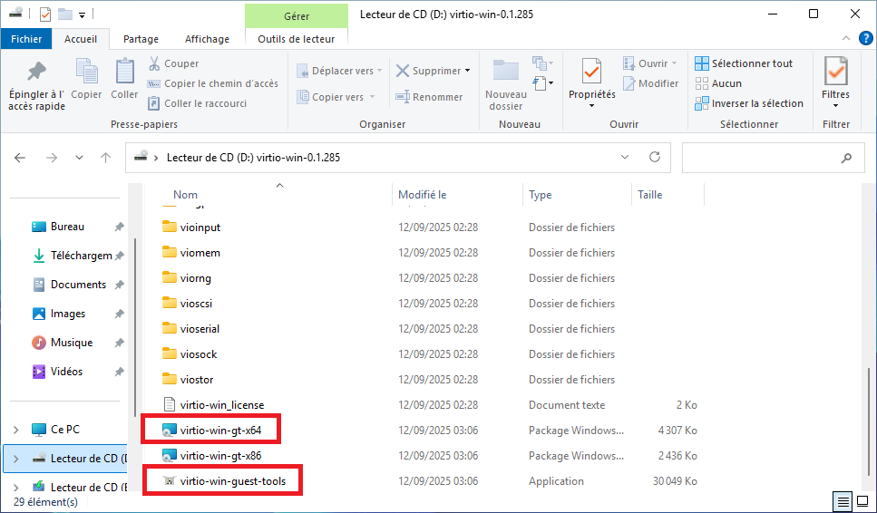{ width="700" }
</figure>

---

