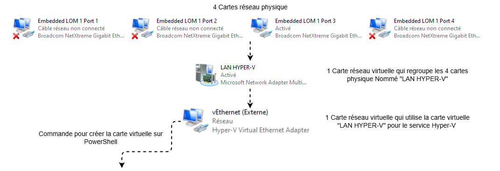

# Serveur 2022

## Divers

### Création carte réseau virtuelle

!!! warning "Attention"

    Il faut d'abord créer un commutateur virtuel `LAN HYPER-V` dans `Gestionnaire de serveur > Serveur local puis Association de cartes réseau`

<figure markdown="span">
  { width="1000" }
</figure>

``` shell
New-VMSwitch -Name "Externe" -NetAdapterName "LAN HYPER-V" -AllowNetlbfoTeams $true -AllowManagement $true
```
